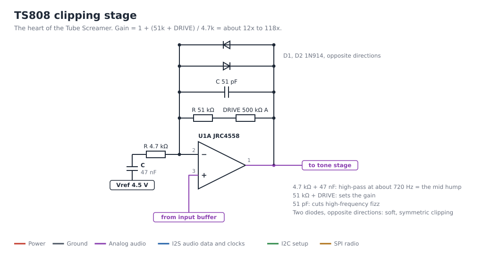

# Analog Pedals

**Step 3 of the project, postponed.** Real circuits: op-amps, transistors, diodes, resistors and capacitors. One box per effect, each with a true-bypass footswitch. The Tube Screamer comes first: it is the reference the digital pedal is compared against.

Shopping list: [SHOPPING_LIST.md](SHOPPING_LIST.md) in this folder. It must be expanded into every part per pedal before ordering.

Each pedal is its own box: PCB, parts, enclosure, 3PDT true-bypass footswitch, jacks, DC jack and LED.

Complete kits (PCB, all parts, drilled enclosure) were not found on AliExpress, so each pedal needs its own full parts list first. A PCB from PedalPCB or Aion FX comes with an exact parts list (BOM). The tables below explain what each part does, so you can follow the circuit. The values come from the TS808 schematic (ElectroSmash analysis) from memory. Check them against your kit's BOM.

## Contents

1. [Schematics](#1-schematics)
2. [Hardware every pedal needs](#2-hardware-every-analog-pedal-needs)
3. [Tube Screamer TS808](#3-tube-screamer-ts808-required-the-reference)
4. [Klon Centaur clone](#4-klon-centaur-clone-optional)
5. [Keeley Katana clone](#5-keeley-katana-clone-optional)
6. [Cost](#6-cost-approximate)
7. [Build](#7-build-tube-screamer-1-evening)
8. [Problems and fixes](#8-problems-and-fixes)

## 1. Schematics

Values from the TS808 schematic as described in the ElectroSmash analysis. Use the parts list of the PCB you build. Redraw with `python3 make_schematics.py` in the repository root.

### True-bypass footswitch (3PDT), the usual wiring

| 3PDT lug | Connects to |
|---|---|
| Row 1: middle / ends | Input jack tip / board input and output jack tip (the switch picks one) |
| Row 2: middle / ends | Output jack tip / board output and input jack (bypass path) |
| Row 3: middle / one end | LED cathode / GND (LED on when the effect is on) |

Most pedal PCBs and "3PDT LED boards" print this on the board. Follow the board's drawing.

## 2. Hardware every analog pedal needs

| Qty per pedal | Part | Notes |
|---|---|---|
| 1 | 3PDT latching footswitch | True bypass. Latching = it clicks on and stays on. Branch B uses momentary switches instead |
| 2 | 6.35 mm mono jacks (open-frame) | Input and output |
| 1 | 2.1 mm DC jack, isolated | Center-negative |
| 1 | LED (3 or 5 mm) and bezel | On/off light |
| 1 | LED resistor, 2.2-4.7 kOhm | Higher value = dimmer |
| 1 | 3PDT LED board (optional) | Makes the footswitch wiring easier |
| 1 | Enclosure: 1590B (TS, Katana) or 125B / 1590BB (Klon) | Pre-drilled if the shop offers it |
| - | Knobs, one per pot | |
| 1 | 9 V battery clip (optional) | |

## 3. Tube Screamer TS808 (required, the reference)

Buy a TS808 PCB (PedalPCB, Aion FX, or "TS808 PCB" on AliExpress) and its parts, or build on stripboard.

| Stage | Parts | What it does |
|---|---|---|
| Power | 1N4001 (polarity protection), 2x 10 kOhm divider + 47 uF = Vref 4.5 V, 100 uF filter cap | Makes a 4.5 V middle point so the op-amp can swing up and down on a single 9 V supply |
| Bypass (original only) | JFETs, transistors, flip-flop | Kits replace this with the 3PDT switch. Skip it |
| Input buffer | 2SC1815 transistor (emitter follower), ~20 nF input cap, 510 kOhm bias resistors, 10 kOhm emitter resistor | High input impedance, so the guitar pickups are not loaded |
| Clipping stage | JRC4558D op-amp (first half). 4.7 kOhm + 47 nF to Vref = 720 Hz high-pass, which creates the mid hump. 51 kOhm + 500 kOhm (log) DRIVE pot in the feedback loop. 51 pF across the loop cuts high frequencies. 2x 1N914/1N4148 diodes back to back in the loop | Gain 12x to 118x. The diodes in the feedback loop give the soft TS clipping |
| Tone and level | 1 kOhm + 220 nF fixed low-pass (~723 Hz), 20 kOhm TONE pot, op-amp second half as active tone stage, 220 Ohm, 1 kOhm, 220 nF, 100 kOhm (log) LEVEL pot | Treble cut/boost and output volume |
| Output buffer | 2SC1815 (emitter follower), 100 Ohm series resistor (TS9: 470 Ohm), 10 kOhm pull-down, 1 uF / 10 uF coupling caps | Low output impedance to drive the cable |

Pots: DRIVE 500 kOhm log (A), TONE 20 kOhm (W/G taper, or B), LEVEL 100 kOhm log (A).
About 25 resistors, 15 capacitors, 1 op-amp with a DIP-8 socket (so you can try other op-amps: JRC4558, TL072, RC4558), 2-3 transistors, 3 diodes, 3 pots.

Every filter in the TS part of `pedal.h` matches a part on this board.

## 4. Klon Centaur clone (optional)

Buy a complete Klon clone kit: PedalPCB "Kliche", Aion FX "Refractor", the General Guitar Gadgets replica kit, or the one from Musikding.

| Part | What it does |
|---|---|
| Charge pump (TC1044SCPA / ICL7660 / LT1054) | Doubles 9 V to about 18 V. More headroom = louder before it distorts |
| 2x TL072 op-amps with sockets | Gain stage, mixing stage, tone, output |
| 2x 1N34A germanium diodes | Hard clipping to ground. In code: `klClip` |
| Dual 100 kOhm (B) GAIN pot | One half sets the gain, the other half mixes clean and dirty. In code: `klGainKnob` sets `klGain` and `klBlend` |
| 10 kOhm (B) TREBLE pot | Active treble control (`klTrebleKnob`) |
| 10 kOhm (B) OUTPUT pot | Volume (`klOutputKnob`) |
| About 60 small parts | 4-6 h of soldering. The hardest board in this project |

Enclosure: 125B.

## 5. Keeley Katana clone (optional)

Buy a Katana-style boost PCB. The PedalPCB forum ("Cleaver" boost) and Aion FX have layouts. Check which Katana version (v1 or v2) the layout copies.
Main parts: JFETs, a charge pump for 18 V headroom, and a VOLUME pot (push/pull for the dirty mode on versions that have it).
Small board, 1-2 h, 1590B enclosure.

No verified Katana schematic was found. Use the BOM that comes with the PCB.

## 6. Cost (approximate)

| Build | Cost |
|---|---|
| TS808 kit, enclosure, hardware | 35-60 EUR |
| Klon kit | 40-80 EUR |
| Katana PCB and parts | 25-40 EUR |

## 7. Build: Tube Screamer (1 evening)

1. [ ] Sort the parts. Measure every resistor with the multimeter.
2. [ ] Solder the lowest parts first: resistors, diodes (check the stripe direction), IC socket, small caps, transistors, electrolytic caps (check polarity), pots.
3. [ ] Wire the jacks, DC jack, 3PDT switch and LED.
4. [ ] Before inserting the op-amp: power on and measure 9 V at socket pin 8 and 4.5 V at Vref.
5. [ ] Insert the 4558 (pin 1 marked with a dot) and play.
6. [ ] Find each stage from the [A1 table](#3-tube-screamer-ts808-required-the-reference) on the board.
7. [ ] Experiments: swap op-amps, replace the 1N914 diodes with 1N34A or LEDs, change C3 from 47 nF to 100 nF. Try the same changes in the tuner's circuit settings.

### Klon and Katana (optional)

Same order. Klon: measure about 17-18 V at the charge pump output before inserting the TL072s.

## 8. Problems and fixes

| Problem | Likely cause |
|---|---|
| Analog pedal: no sound, no LED | A diode or electrolytic cap is reversed. Check Vref = 4.5 V |
| Klon: weak or distorts too early | The charge pump does not give about 18 V |

## Not verified yet

- The part values on this page are from the TS808 schematic from memory. The parts list of your PCB is correct.
- No verified Katana schematic was found.
