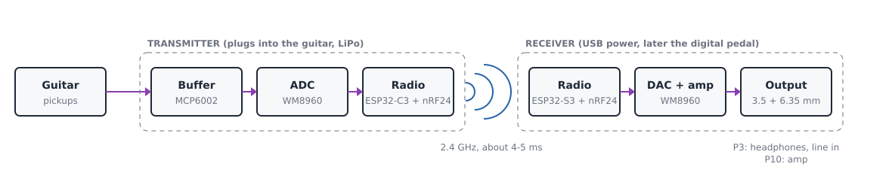
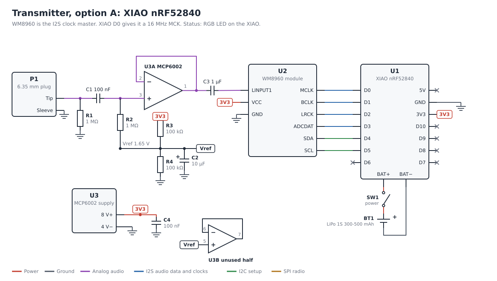
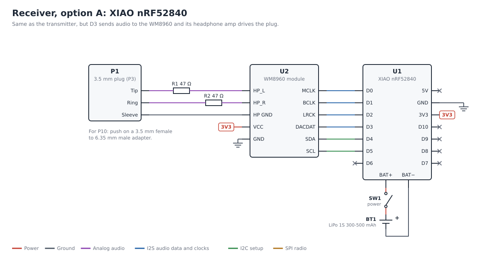
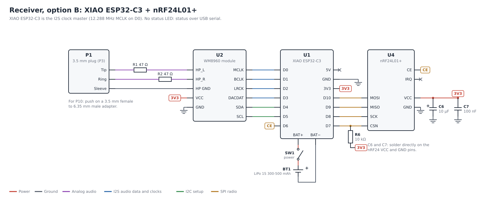

# Wireless Guitar System

**Step 1 of the project.**

A cable replacement for the guitar. A small **transmitter** plugs straight into the guitar. A small **receiver** plugs into headphones or a line input (3.5 mm, "P3"), or into the amp (6.35 mm, "P10") with a push-on adapter. Both run on a small rechargeable battery inside a 3D-printed case. Only the plug sticks out.

| | |
|---|---|
| Latency | About 4-5 ms (estimate), like standing 1.5 m from the amp |
| Battery | 300-500 mAh LiPo per side, charged over USB-C |
| Range | About 10 m indoors (estimate) |
| Parts cost | About 60 EUR for both sides (about 40 EUR with the cheaper options in the shopping list), without spares or tools |
| Parts list | [SHOPPING_LIST.md](../SHOPPING_LIST.md), section 8 (option A) or 9 (option B) |

Want it working today instead? A ready-made 2.4/5.8 GHz set costs 25-40 EUR on AliExpress (search "guitar wireless system 5.8GHz"). This project is for learning and for later joining it to the pedal.

## Contents

1. [Choose an option](#1-choose-an-option)
2. [How the signal travels](#2-how-the-signal-travels)
3. [The input buffer, explained](#3-the-input-buffer-explained)
4. [Schematics](#4-schematics)
5. [Parts](#5-parts)
6. [Build: breadboard, soldered board, case](#6-build-breadboard-soldered-board-case)
7. [Firmware](#7-firmware)
8. [Problems and fixes](#8-problems-and-fixes)
9. [Not verified yet](#9-not-verified-yet)

---

## 1. Choose an option

Both options use the same audio parts (WM8960 codec, MCP6002 buffer), the same battery, plugs and case. Only the brain and the radio differ.

| | **Option A: XIAO nRF52840** (recommended) | **Option B: XIAO ESP32-C3 + nRF24L01+** |
|---|---|---|
| Boards per side | 1 | 2 |
| Audio | 48 kHz, 16-bit, lost packets resent | 32 kHz, 16-bit, no resends (the nRF24 sends only 32 bytes per packet) |
| Latency (estimate) | About 4.5 ms | About 4 ms |
| Battery life, 400 mAh (estimate) | 13-20 h | About 7 h |
| Status LED | RGB LED on the XIAO | None (every pin is used). Status over USB serial |
| Programming | nRF Connect SDK (Zephyr). New to learn | Arduino / PlatformIO, same as the pedal |

Choose A for battery life and fewer parts. Choose B to stay with Arduino.

### Why not Bluetooth?

Distance is not what makes a link slow. Radio covers 10 m in about 0.00003 ms. The delay comes from how the protocol schedules and packs the audio:

| Link | Delay |
|---|---|
| Bluetooth headphones (A2DP) | 100-200 ms |
| Bluetooth LE Audio | 20-40 ms |
| Bluetooth LE, own data | At least 7.5 ms per message, the shortest interval BLE allows |
| Nordic ESB (option A) or nRF24 (option B) | Under 1 ms per packet |

"Almost instant" Bluetooth usually means a short connection interval, at its best 7.5 ms just for the radio. Option A uses the same radio chip as Bluetooth LE (the nRF52840), but with Nordic's simpler protocol, which has no fixed interval.

## 2. How the signal travels

1. **Buffer:** the MCP6002 copies the guitar signal without loading the pickups ([section 3](#3-the-input-buffer-explained)).
2. **ADC:** the WM8960 turns it into numbers: 48,000 per second (option A).
3. **Radio:** the XIAO packs 48 numbers (1 ms of sound) into a packet and sends it. The receiver confirms each packet. A lost packet is sent again.
4. **Jitter buffer:** the receiver keeps 2 packets in stock, so a late packet does not cause a click.
5. **DAC:** the receiver's WM8960 turns the numbers back into sound. Its headphone amp drives the plug.

| Step | Time |
|---|---|
| Fill one packet | 1.0 ms |
| Radio, with one resend | About 0.5 ms |
| Jitter buffer, 2 packets | 2.0 ms |
| Converter buffers | About 1 ms |
| **Total** | **About 4.5 ms** |

## 3. The input buffer, explained

**Why a buffer is needed.** A guitar pickup is a weak signal source. Connected straight to the WM8960 (input resistance a few kOhm to tens of kOhm), the pickup gets loaded and loses its treble: the sound gets dull. The buffer has a very high input resistance, so the pickup "sees" almost nothing, and a strong output that drives the WM8960 easily.

**What a voltage follower is.** U3A is an op-amp whose output (pin 1) is wired straight back to its minus input (pin 2). An op-amp always tries to make its two inputs equal. With the output tied to the minus input, the output simply copies the plus input (pin 3): gain 1, same wave. The difference is strength: the input takes almost no current, the output can supply plenty.

**Why the 1.65 V.** The op-amp runs on 3.3 V and ground only. It cannot output a negative voltage, but the guitar wave goes below 0 V half the time. So the wave is lifted to the middle of the supply:

| Part | What it does |
|---|---|
| C1 100 nF | Passes the wave, blocks DC. The guitar never sees the 1.65 V |
| R2 1 MOhm | Pulls the wave's center to Vref = 1.65 V (point 2). Its high value keeps the input "light" |
| R1 1 MOhm | Keeps the input at 0 V when nothing is plugged in. No pop when plugging in |
| R3, R4 100 kOhm | Divide 3.3 V in half: Vref = 1.65 V |
| C2 10 uF | Keeps Vref steady and quiet |
| C3 1 uF | Removes the 1.65 V again before the WM8960 (point 3) |
| C4 100 nF | Supply filter, placed right at U3 pin 8 |
| U3B | The second op-amp in the chip is not needed. It is wired as a follower on Vref so it stays quiet |

The guitar sees R1 and R2 in parallel: 500 kOhm, the same as most overdrive pedals. For about 1 MOhm, change R1 to 10 MOhm.

## 4. Schematics

Each drawing is a complete board. Labels with the same name (`3V3`, `Vref`, `CE`) are connected. The XIAO pins are drawn in their real order, as printed on the board. The SVG files are in [schematics/](schematics/); [make_schematics.py](../make_schematics.py) in the repository root redraws them (`python3 make_schematics.py`).

### Option A: transmitter

### Option A: receiver

### Option B: transmitter

### Option B: receiver

### Connection list (all four boards)

The same list as text, to tick off while soldering.

| XIAO pin | Goes to | Signal | Notes |
|---|---|---|---|
| D0 | WM8960 MCLK | I2S master clock | Option A: 16 MHz, the WM8960 PLL makes 48 kHz. Option B: 12.288 MHz |
| D1 | WM8960 BCLK | I2S bit clock | Option A: from the WM8960. Option B: from the XIAO |
| D2 | WM8960 LRCK (ADCLRC / DACLRC) | I2S word clock | Same direction as BCLK. Some modules join ADCLRC and DACLRC |
| D3 | WM8960 ADCDAT (transmitter) or DACDAT (receiver) | Audio data | |
| D4 | WM8960 SDA | I2C data | Setup only. Most modules have pull-ups |
| D5 | WM8960 SCL | I2C clock | |
| D6 | nRF24 CE | Radio enable | Option B only |
| D7 | nRF24 CSN | SPI chip select | Option B only. 10 kOhm pull-up to 3V3 (R6) |
| D8 | nRF24 SCK | SPI clock | Option B only |
| D9 | nRF24 MISO | SPI data in | Option B only |
| D10 | nRF24 MOSI | SPI data out | Option B only |
| 3V3 | WM8960 VCC, MCP6002 pin 8, R3, nRF24 VCC | 3.3 V | |
| GND | Everything's ground | | One ground point |
| BAT+ / BAT- (pads underneath) | LiPo + through SW1 / LiPo - | Battery | The XIAO charges the battery over USB-C |
| 5V | Not connected | | |

| Other wires | |
|---|---|
| Transmitter: plug tip -> buffer (section 3) -> C3 -> WM8960 LINPUT1. Plug sleeve -> GND | |
| Receiver: WM8960 HP_L -> R1 47 Ohm -> plug tip. HP_R -> R2 47 Ohm -> plug ring. Headphone ground -> plug sleeve | The 47 Ohm protect the outputs when a mono 6.35 mm jack shorts the ring |
| Option B: C6 10 uF and C7 100 nF across nRF24 VCC and GND, soldered on the module pins | Without them the nRF24 fails at random |

## 5. Parts

Per side. Buy links and spares are in the [shopping list](../SHOPPING_LIST.md).

| Ref | Part | Transmitter | Receiver |
|---|---|---|---|
| U1 | XIAO nRF52840 (A) or XIAO ESP32-C3 (B) | 1 | 1 |
| U2 | WM8960 module | 1 | 1 |
| U3 | MCP6002 (DIP-8 on breadboard, SOIC-8 on a PCB) | 1 | - |
| U4 | nRF24L01+, mini SMD for the case (B only) | 1 | 1 |
| R1, R2 | 1 MOhm | 2 | - |
| R3, R4 | 100 kOhm | 2 | - |
| R1, R2 (receiver) | 47 Ohm | - | 2 |
| R6 | 10 kOhm (B only) | 1 | 1 |
| C1 | 100 nF film or C0G ceramic | 1 | - |
| C2 | 10 uF | 1 | - |
| C3 | 1 uF | 1 | - |
| C4 | 100 nF ceramic | 1 | - |
| C5 | 100 nF ceramic at the WM8960 power pins, only if the module has none | 1 | 1 |
| C6, C7 | 10 uF + 100 nF (B only) | 1 each | 1 each |
| P1 | 6.35 mm mono male plug (transmitter), 3.5 mm stereo male plug (receiver) | 1 | 1 |
| SW1 | Mini slide switch | 1 | 1 |
| BT1 | LiPo 1S 300-500 mAh with protection board, JST-PH | 1 | 1 |
| - | 3.5 mm female to 6.35 mm male adapter | - | 1 |

## 6. Build: breadboard, soldered board, case

### Stage 1: breadboard

1. Solder pin headers on the XIAO and the WM8960 module.
2. Flash a test program to both XIAOs ([section 7](#7-firmware), steps 1-2) before wiring audio.
3. Build the receiver first: XIAO + WM8960, play a test tone into headphones.
4. Build the transmitter buffer. Measure 1.65 V at Vref and at U3 pin 1 with nothing plugged in.
5. Join both sides and test with phone audio, then the guitar.

### Stage 2: soldered board

Hand-wired double-sided prototype board, cut to the size of the case.

- Put the XIAO and the WM8960 on female headers, so either can be replaced.
- Stack the boards: buffer board, WM8960, XIAO on top.
- Short wires. Keep the buffer input wire (plug to C1) short and away from the XIAO.
- Check every connection with the multimeter (continuity) before connecting the battery.

### Stage 3: custom PCB (optional)

Draw the schematic in KiCad, make a board shaped to the case, order from JLCPCB or PCBWay (about 5 USD for 5 boards plus shipping). Smallest and strongest.

### The 3D-printed case

- Openings: the plug, USB-C (charging and flashing), the slide switch, and a thin wall or small hole over the LED.
- No metal near the XIAO antenna (the end away from the USB-C port). No metallic paint or foil.
- The plug carries the whole box. Clamp its metal barrel between the case halves, or screw it into a printed boss with its nut. Close with M2 screws in heat-set inserts.
- PETG is stronger than PLA and survives a hot car.
- Guitar jacks differ: recessed (Stratocaster), on the side (Les Paul), in a cup (Telecaster). Print the plug end first and try it on your guitar. Use the right-angle plug if a straight case hits the body.
- Pad the battery and keep it away from the plug, so a fall cannot puncture it.
- The slide switch cuts the battery, so the battery charges only with the switch on.

## 7. Firmware

| | Option A | Option B |
|---|---|---|
| Tools | nRF Connect SDK (Zephyr) in VS Code, board `xiao_ble` | PlatformIO, Arduino framework, board `seeed_xiao_esp32c3`, `RF24` library |
| Flashing | Double-press reset, a USB drive appears, copy the `.uf2` file | USB-C, like the pedal's ESP32 |
| Radio | ESB, 2 Mbit/s, 48 samples per packet, 1-2 resends | nRF24 at 2 Mbit/s, 15 samples per packet, no auto-acknowledge |
| I2S | WM8960 is master, XIAO is slave | XIAO is master |

Both: the receiver handles lost packets (repeat the last one with a fade-out, then silence) and clock drift (the two crystals differ by 20-40 ppm: drop or repeat one sample when the jitter buffer drifts). Later in `firmware/tx` and `firmware/rx`.

1. [ ] Blink test on both XIAOs.
2. [ ] Radio only: send 1000 numbered packets per second, count the lost ones at 1, 5 and 10 m, with your body in between.
3. [ ] Receiver: WM8960 setup over I2C, play a 440 Hz tone. Headphones, then the amp through the adapter.
4. [ ] Transmitter: WM8960 setup, print the input level over USB serial with phone audio as input.
5. [ ] Both: phone audio in, headphones out. Then the guitar.
6. [ ] Measure the latency: dry guitar on one input of an audio interface, receiver output on the other. Read the delay in Audacity.
7. [ ] Tune the jitter buffer, packet size and radio channel.
8. [ ] Battery level on the LED (option A). Do not read the battery voltage while charging (Seeed warning about pin P0.14).

## 8. Problems and fixes

| Problem | Likely cause |
|---|---|
| Clicks every few seconds | Jitter buffer too small, or drift correction not working |
| Dropouts at a distance | Body between transmitter and receiver, antenna near metal, busy channel |
| Dull sound | Buffer missing or bypassed, or R2 is not 1 MOhm |
| Hiss | WM8960 input gain too high. A hard strum should reach about -6 dBFS |
| No sound at all | WM8960 not set up (check I2C), no MCLK, or wrong I2S master/slave setting |
| Option B: board does not start | nRF24 pulling D9 (a boot pin) low. Check the R6 pull-up on CSN |
| Option B: radio works sometimes | Missing C6/C7 on the nRF24, or a fake chip |
| Battery does not charge | Slide switch off |

## 9. Not verified yet

- The WM8960 module: size, pin names and how it grounds its headphone output vary by seller. If its headphone ground is "OUT3" (capless mode), do not connect it to GND: then add 220 uF caps in series with HP_L and HP_R and use GND for the sleeve.
- The WM8960 PLL making 48 kHz from a 16 MHz MCK (option A). Check the datasheet.
- Whether the XIAO 3V3 pin supplies enough current for the headphone amp at high volume.
- XIAO pin order: check against the Seeed pinout before soldering.
- Latency, range and battery life are estimates, not measurements.

Sources: [Seeed XIAO nRF52840 wiki](https://wiki.seeedstudio.com/XIAO_BLE/), [SparkFun WM8960 hookup guide](https://www.digikey.com/en/maker/projects/audio-codec-breakout-wm8960-hookup-guide/64b54a59f8004b81ad76ab21cb7f2c65).

## Ideas for later

- Pairing button, so two systems can work in the same room.
- Channel hopping when a channel is busy.
- The digital pedal as the receiver.
